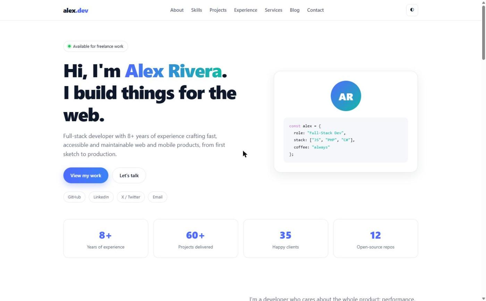

# Developer Portfolio Landing Page

A free, responsive developer portfolio template built with plain HTML5, CSS3 and JavaScript, no framework. Hero, stats, skills with animated bars, filterable projects, experience timeline and a contact form, ready to download and make your own.



**[Live Demo](https://lenivalestevao.github.io/developer-portfolio-landing-page/)**

## Features

- Sticky header with mobile menu
- Light and dark mode (remembers the visitor's choice, respects system preference)
- Hero section with availability badge and social links
- Animated stats strip
- Skills grouped by area with animated progress bars
- Projects grid with category filter
- Experience timeline
- Contact form that opens the visitor's email app, so no backend is needed
- Fully responsive and keyboard friendly
- Zero dependencies: pure HTML, CSS and vanilla JavaScript

## Getting Started

1. Download or clone this repository
2. Open `index.html` in your browser. No build step required

## Customization

**Content:** your name, links, skills, projects and experience are plain JavaScript arrays at the top of `script.js`. Edit them and the page re-renders itself. Also update the name, title and email in `index.html`.

**Colors:** all colors live as CSS custom properties at the top of `style.css`:

```css
:root {
  --primary: #4f6bff;
  --accent: #14b8a6;
  ...
}
```

## Deploy for free

Enable **GitHub Pages** (Settings, Pages, Deploy from branch `main`) and your portfolio is online in a minute.

## Project Structure

```
developer-portfolio-landing-page/
├── index.html   # Page structure
├── style.css    # Design tokens, layout, dark mode
├── script.js    # Your content + rendering
└── README.md
```

## License

MIT. Free to use for personal or commercial projects. A link back is appreciated but not required.

Made by [Leni Junior](https://github.com/lenivalestevao). Check out my other free templates on my profile.
